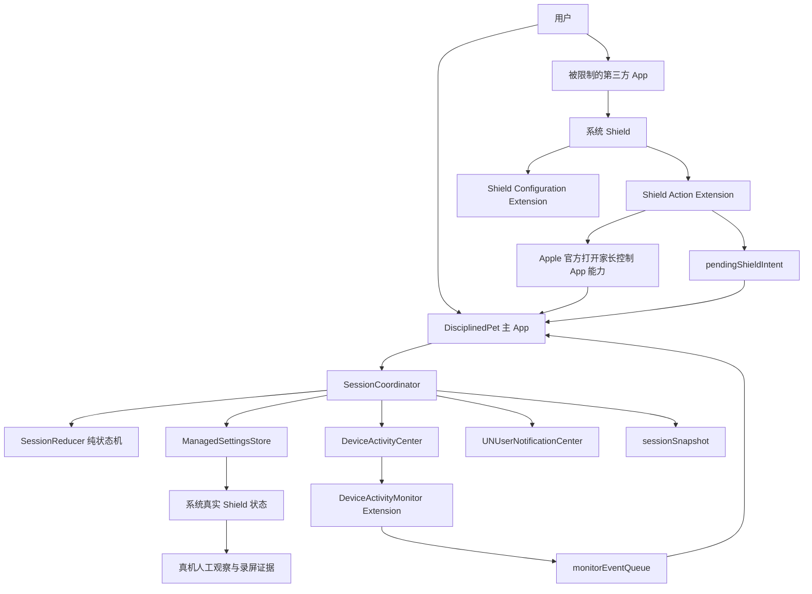
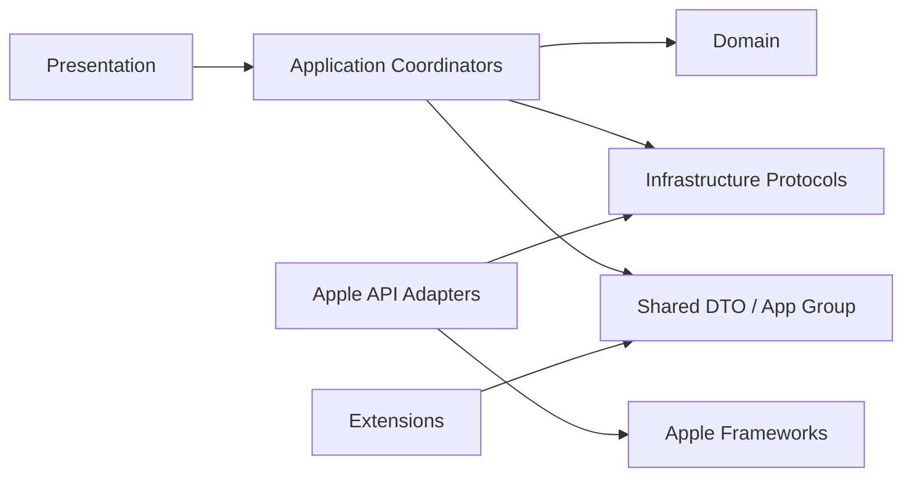

# 自律宠物 iOS 工程架构 v1.0

> 文档状态：待用户工程架构审查  
> 日期：2026-08-10  
> 对应权威产品文档：[自律宠物 PRD v0.1.4](/Users/USER/Documents/app/自律宠物_PRD_v0.1.4_2026-08-10.md)  
> 适用阶段：P0 技术门禁  
> 性质：工程架构规格，不是开发授权，不证明 Apple 核心能力已通过  
> 计划项目路径：`/Users/USER/Documents/app/自律宠物-iOS`（当前尚未创建）

---

## 1. 架构结论

P0 采用 **原生 SwiftUI + Apple Screen Time API + 本地状态机 + App Group 跨进程通信**。

工程由四个可运行产品 Target 和一个本地单元测试 Target 组成：

1. 主 App；
2. Device Activity Monitor Extension；
3. Shield Configuration Extension；
4. Shield Action Extension；
5. Core Tests，仅用于本地单元测试，不属于用户安装后的运行拓扑。

核心原则：

- P0 只验证 Apple 原生限制闭环，不制作正式宠物资产；
- 主 App 是产品状态机和业务流程的唯一协调者；
- `ManagedSettingsStore` 负责发出实际施加或解除 Shield 的命令；
- 系统通知只负责提醒，不是状态转换的唯一依据；
- `DeviceActivityMonitor` 记录系统生命周期事件并辅助恢复，不充当唯一时钟；
- App、Shield Extension 和 Monitor 是独立进程，不能用 Swift Actor 冒充跨进程锁；
- 共享数据采用“每类记录只有一个写入者”的规则；
- Build、Simulator 或本地布尔状态不能证明真实 Shield 已经出现、解除或恢复；
- 只有指定真实 iPhone 17 上的可观察证据才能决定 P0 PASS/FAIL。

---

## 2. 第一性原理与架构目标

### 2.1 根目标

P0 唯一需要回答：

> Apple 公开能力是否允许稳定完成“Shield 申请 → 打开主 App → 填写原因 → 解除本次全部已选受限 App → 10/30/60 分钟提醒 → 用户返回后重新限制全部对象”。

### 2.2 必要条件

要判定闭环成立，必须同时满足：

1. 用户能完成 Family Controls 授权并选择受限 App；
2. 选择集合能被 Shield 实际保护；
3. Shield Action 能形成可理解的主 App 申请路径；
4. 申请流程能显示原目标、解除范围、原因和 10/30/60 分钟规则；
5. 主 App 能解除本次全部已选受限 App；
6. 通行窗口使用持久化时间戳，不因 App 进入后台或被终止而丢失；
7. 用户返回时能重新限制全部对象；
8. 60 分钟未返回时结束本次专注、停止提醒、不给奖励，并按 PRD 保持受限 App 解除；
9. 产品不能把“命令已发出”显示成“系统已经成功”；
10. 所有关键能力只使用 Apple 公开 API。

### 2.3 非目标

P0 不负责证明：

- 宠物是否提高留存；
- 猫、狗、兔的美术偏好；
- 好感度、共同回忆或纪念卡是否有效；
- 商业化和付费意愿；
- 每个 App 的真实前台使用时长；
- 精确 Screen Time 报表；
- 最低 iOS 支持版本；
- App Store 审核一定通过。

---

## 3. 技术基线

| 项目 | P0 决策 |
|---|---|
| UI | SwiftUI |
| 语言 | Swift 6.3 |
| 并发 | Swift Strict Concurrency |
| 状态观察 | Observation / `@Observable` |
| 导航 | 单一 `NavigationStack` + 类型化 `AppRoute` |
| 系统限制 | FamilyControls + ManagedSettings + ManagedSettingsUI |
| 系统计划 | DeviceActivity |
| 通知 | UserNotifications 本地通知 |
| 跨 Target 通信 | App Group |
| P0 持久化 | App Group `UserDefaults` 中的独立 Key + 编码 `Data` |
| 单元测试 | Swift Testing |
| 第三方运行时依赖 | 无 |
| 服务端、账号、同步 | 无 |
| 分析 SDK | 无 |
| 精确使用时长报表 | 无 |

当前本机工具链基线为 Xcode 26.6、Swift 6.3.3。P0 不使用要求 Swift 6.4 或 Xcode 27 beta 的 API。第一轮真机为 iPhone 17、iOS 27.0；最低支持版本在 P0 后决定。

---

## 4. Target 拓扑与标识

### 4.1 产品 Target

| Target | 类型 | Bundle ID | 责任 |
|---|---|---|---|
| `DisciplinedPet` | iOS App | `com.cczij.disciplinedpet` | 授权、选择 App、专注状态机、申请、通知、返回、诊断 |
| `DisciplinedPetMonitor` | Device Activity Monitor Extension | `com.cczij.disciplinedpet.monitor` | 接收 DeviceActivity 生命周期回调、写入 Monitor 事件 |
| `DisciplinedPetShieldConfiguration` | Shield Configuration Extension | `com.cczij.disciplinedpet.shieldconfiguration` | 提供 Shield 的文案、按钮和最小外观 |
| `DisciplinedPetShieldAction` | Shield Action Extension | `com.cczij.disciplinedpet.shieldaction` | 处理 Shield 按钮、写入申请意图、尝试打开主 App |

共同 App Group：

```text
group.com.cczij.disciplinedpet
```

以上 Extension 名称和 Bundle ID 是本架构的冻结建议。用户验收本文件后，才作为 P0 创建依据。

### 4.2 测试 Target

| Target | 类型 | 责任 |
|---|---|---|
| `DisciplinedPetCoreTests` | Unit Test Bundle | 测试纯状态机、时间边界、幂等、过期事件和恢复逻辑 |

测试 Target 不增加用户设备上的扩展，不改变“四个产品 Target”的运行拓扑。

### 4.3 P0 暂不创建的 Target

- Device Activity Report Extension；
- Widget Extension；
- Live Activity；
- Share Extension；
- Watch App；
- UI Test Target；
- 独立数据库或网络模块。

---

## 5. 总体运行架构



重要区别：

- `SessionCoordinator` 知道产品希望系统执行什么；
- `ManagedSettingsStore` 能发出限制命令；
- P0 诊断页能记录命令、时间和错误；
- 但 App 没有通用、可靠的“Shield 已经肉眼可见”真值回调；
- 因此真实 Shield 结果必须单独以真机观察和录屏取证。

---

## 6. 主 App 分层

### 6.1 Presentation

负责 SwiftUI 页面和用户输入：

- `AuthorizationView`
- `AppSelectionView`
- `FocusSetupView`
- `FocusSessionView`
- `AccessRequestView`
- `AccessWindowView`
- `ReturnToFocusView`
- `P0DiagnosticsView`

规则：

- 根视图只组装页面，不承载完整业务流程；
- 多区域页面拆成独立 `View` 类型，不用大量 computed view 伪拆分；
- 子视图只接收实际显示的数据，避免传入整个大状态对象；
- 页面本地状态使用 `private @State`；
- App 级可变 UI 状态由 `@MainActor @Observable` 对象持有；
- P0 只有一个根 `NavigationStack`，不引入 `TabView`。

### 6.2 Application

负责用例协调和副作用编排：

- `SessionCoordinator`
- `AuthorizationCoordinator`
- `AccessRequestCoordinator`
- `NotificationResponseBridge`
- `AppLifecycleReconciler`
- `P0DiagnosticsModel`

其中 `SessionCoordinator`：

- 标记为 `@MainActor @Observable`；
- 由 App 根部通过 `@State` 持有；
- 调用纯状态机生成下一状态和待执行 Effect；
- 调用系统 Client 执行 Effect；
- 记录本地命令结果；
- 不直接声称系统 Shield 已经成功变化。

### 6.3 Domain

负责无 UI、可测试的产品规则：

- `FocusSession`
- `FocusSessionState`
- `AccessWindow`
- `AccessReason`
- `SessionEvent`
- `SessionEffect`
- `SessionReducer`
- `SessionDeadlinePolicy`
- `RewardEligibility`

Domain 类型优先采用不可变 `struct`/`enum`，并符合：

```text
Codable + Equatable + Sendable
```

状态机不直接调用 Family Controls、通知、文件系统或当前时间。

### 6.4 Infrastructure

负责 Apple API 和本地存储适配：

- `FamilyControlsAuthorizationClient`
- `ActivitySelectionStore`
- `ShieldProtectionClient`
- `DeviceActivityScheduleClient`
- `LocalNotificationClient`
- `AppGroupStore`
- `ProductEventStore`
- `SystemClock`

这些能力均通过协议注入到协调器，单元测试使用内存实现。

---

## 7. 导航设计

### 7.1 路由类型

```text
AppRoute
├── authorization
├── appSelection
├── focusSetup
├── focusSession(sessionID)
├── accessRequest(intentID)
├── accessWindow(sessionID)
└── diagnostics
```

`AppRoute` 使用稳定标识并符合 `Hashable`。Router 使用：

- `@MainActor`
- `@Observable`
- 类型化 `[AppRoute]`
- 单一 `.navigationDestination(for:)` 映射

### 7.2 Shield 到主 App

P0 首选路径：

1. Shield Action 收到用户“申请使用”操作；
2. Extension 生成唯一 `intentID`；
3. 将 `PendingShieldIntent` 写入 App Group；
4. 使用 Apple 官方可用能力请求打开家长控制 App；
5. 主 App 进入 active；
6. `AppLifecycleReconciler` 读取 pending intent；
7. 校验 schema、sessionID、generation 和是否已消费；
8. Router 进入 `.accessRequest(intentID:)`；
9. 成功消费后在主 App 自己的 snapshot 中记录消费位置。

P0 不注册自定义 URL Scheme，也不配置 Universal Link。

如果首选官方打开方式在真机不可用，只允许测试 Apple 官方公开能力范围内的替代路径。不得使用私有 API，不得显示虚假跳转成功状态。

### 7.3 通知返回入口

通知的“返回专注”动作负责唤起主 App。主 App 激活后：

1. 读取当前 session snapshot；
2. 检查是否处于 `ACCESS_WINDOW_ACTIVE`；
3. 检查当前时间是否已经达到 60 分钟截止点；
4. 未超时则进入统一重锁流程；
5. 超时则校正为 `ACCESS_TIMED_OUT`，不再重锁。

通知动作不直接修改完整业务状态。

---

## 8. 状态机设计

### 8.1 产品状态

与 PRD 保持一致：

```text
IDLE
  → FOCUSING
      → ACCESS_REQUESTED
          → ACCESS_WINDOW_ACTIVE
              → FOCUSING_INTERRUPTED
              → ACCESS_TIMED_OUT
      → COMPLETED
      → ABANDONED
```

补充的工程瞬时状态只用于防止重复副作用：

```text
APPLYING_SHIELD
CLEARING_SHIELD
REAPPLYING_SHIELD
RECOVERY_REQUIRED
```

瞬时状态不能替代 PRD 的产品状态，也不能显示成系统结果。

### 8.2 纯状态机输入

`SessionReducer` 只接收：

- 当前 `FocusSession`；
- 一个明确的 `SessionEvent`；
- 由外部注入的当前时间；
- 已知的本地命令结果。

它输出：

- 新 `FocusSession`；
- 零个或多个 `SessionEffect`。

示例 Effect：

- `applyShield(selection)`
- `clearShield(selection)`
- `scheduleAccessReminders(deadline)`
- `cancelAccessReminders`
- `scheduleFocusMonitoring`
- `persistSnapshot`
- `appendProductEvent`

Reducer 本身不执行 Effect，避免测试被系统 API、线程和真实时间污染。

### 8.3 时间权威

通行窗口的逻辑权威是持久化时间戳：

```text
accessWindowStartedAt
accessWindowDeadline = accessWindowStartedAt + 60 分钟
```

10、30、60 分钟提醒从同一个开始时间派生。

每次以下入口发生时，必须先执行 deadline reconciliation：

- App 启动；
- App 从后台进入 active；
- 收到通知响应；
- 消费 Shield pending intent；
- DeviceActivity Monitor 写入新事件；
- 用户点击返回专注；
- 用户尝试完成或放弃。

如果当前时间已经达到截止点：

- 状态校正为 `ACCESS_TIMED_OUT`；
- 取消剩余返回提醒；
- 本次无奖励；
- 按 PRD 保持已选 App 解除；
- 不显示仍在专注或仍受保护。

### 8.4 返回专注

只有以下步骤完成后，才把通行窗口结束并恢复专注：

1. 用户从主 App 或通知动作明确点击返回；
2. 尚未达到 60 分钟截止点；
3. 主 App向本次完整选择集合发出重新施加 Shield 的命令；
4. 本地记录命令结果；
5. 真机验收阶段另外观察真实 Shield 是否恢复。

用户锁屏、切换 App 或通知消失都不等于返回专注。

### 8.5 主动放弃

主动放弃流程：

1. 显示二次确认；
2. 确认后取消剩余提醒；
3. 发出解除本次 Shield 的命令；
4. 状态变为 `ABANDONED`；
5. 本次不获得奖励；
6. 记录放弃事件和后续 30 分钟内是否重新开始。

P0 不添加放弃冷静期。

---

## 9. 跨进程状态与并发安全

### 9.1 物理事实

以下组件运行在不同进程：

- 主 App；
- Shield Action Extension；
- DeviceActivity Monitor Extension。

因此：

- `actor` 只能保护所属进程内的内存；
- `NSLock`、`Mutex` 或串行队列不能自动保护其他进程；
- 所有进程共同改写一个大 JSON 对象会产生覆盖和竞态；
- App Group 是运输层，不是事务数据库。

### 9.2 单写入者协议

| 记录 | 唯一写入者 | 读取者 |
|---|---|---|
| `sessionSnapshot` | 主 App | 主 App、Extensions |
| `pendingShieldIntent` | Shield Action Extension | 主 App |
| `monitorEventQueue` | Device Activity Monitor Extension | 主 App |
| `productEventHistory` | 主 App | 主 App |

主 App不删除或覆盖 Extension 的源记录，而是通过自己的 `lastConsumedIntentID` 和 `lastConsumedMonitorSequence` 记录消费位置。

### 9.3 记录信封

所有跨进程记录都包含：

```text
schemaVersion
sessionID
generation
recordID 或 sequence
createdAt
payload
```

其中：

- `schemaVersion`：支持未来数据迁移和拒绝未知结构；
- `sessionID`：防止旧会话事件进入新会话；
- `generation`：每次会话关键重建时递增；
- `recordID`：Shield intent 幂等消费；
- `sequence`：Monitor 事件顺序消费；
- `createdAt`：诊断和过期判断。

### 9.4 P0 存储选择

P0 使用：

```text
UserDefaults(suiteName: "group.com.cczij.disciplinedpet")
```

每类记录使用独立 Key，并存储 `Codable` 编码后的 `Data`。

这样做的理由：

- P0 共享载荷很小；
- 每个 Key 有唯一写入者；
- 不引入数据库和文件协调器；
- 可在诊断页显示 schema、ID、sequence 和时间。

限制：不同 Key 之间没有原子事务保证。因此不能依赖“多个 Key 同时提交”，必须依靠 generation、ID 和启动时 reconciliation 恢复一致性。

如果 P0 实测发现 UserDefaults 跨进程可见性或恢复行为不满足要求，再单独评估 App Group 文件容器；不在开工前预先增加第二套存储。

### 9.5 Swift 并发规则

- 主 App UI、Router、Coordinator：`@MainActor`；
- 主 App Target 可以使用 MainActor 默认隔离；
- Shared 和 Extension 类型必须显式声明隔离，不依赖隐式默认；
- 跨进程 DTO 使用不可变 `Codable & Sendable` 值类型；
- 不使用 `@unchecked Sendable`；
- 不使用 `nonisolated(unsafe)`；
- 不在 actor 内增加手动锁；
- 不使用 `Task.detached` 处理普通业务流程；
- 不在主线程执行重型编码、文件扫描或阻塞等待；
- 不用 `Task.sleep` 维持产品计时。

共享 Swift 文件可加入所需 Target membership，但其中运输类型必须显式 `nonisolated`、不可变并保持相同编码结构，避免因不同 Target 默认隔离设置产生语义漂移。

---

## 10. Apple 能力适配边界

### 10.1 Family Controls

负责：

- 请求 Family Controls 授权；
- 展示 Family Activity Picker；
- 获得用户主动选择的应用、类别或网页域 Token。

不能据此声称：

- entitlement 已获批；
- App Store 一定允许；
- 用户一定愿意授权。

### 10.2 Managed Settings

负责：

- 对本次选择集合施加 Shield；
- 清除本次选择集合的 Shield；
- 用户返回时重新施加完整集合。

所有写入必须集中在 `ShieldProtectionClient`，禁止页面到处直接操作 `ManagedSettingsStore`。

P0 不把 `stopMonitoring` 当成解除 Shield 的方法，也不假设存在可靠的“解除完成”回调。

### 10.3 Shield Configuration

仅承担最小 P0 展示：

- 返回专注；
- 申请使用；
- 简洁、无正式宠物资产的说明。

P0 不在 Shield 中输入自由文本。原因选择和自定义原因都在主 App 完成。

### 10.4 Shield Action

只做短操作：

- 接收用户动作；
- 写入 pending intent；
- 防止重复 intent 造成重复导航；
- 尝试打开主 App；
- 返回系统支持的动作响应。

不得：

- 在 Extension 内运行完整状态机；
- 在 Extension 内保存原因正文；
- 在 Extension 内展示复杂 UI；
- 等待主 App 回写；
- 记录或展示原始 Token。

### 10.5 Device Activity Monitor

负责：

- 接收 interval 生命周期回调；
- 生成带 sequence 的 Monitor 事件；
- 为状态恢复提供辅助证据。

不负责：

- 作为产品唯一计时器；
- 直接宣布用户已经完成专注；
- 替代主 App 的 deadline reconciliation；
- 在 60 分钟通行超时后重新施加 Shield。

---

## 11. 通知架构

P0 使用一个本地通知 Client 管理：

- 10 分钟温和召回；
- 30 分钟超时警示；
- 60 分钟专注结束通知；
- 返回专注 Action。

规则：

1. 三个通知共用一个通行窗口和一个 deadline；
2. 通知标识包含 sessionID 和 generation；
3. 用户返回或放弃时取消尚未触发的通知；
4. 通知权限关闭仍允许开始和申请；
5. UI 必须明确“提醒不可用”；
6. 60 分钟状态仍由持久化时间戳计算；
7. 通知投递、点击或消失不直接证明状态完成；
8. 通知中不写自定义原因正文；
9. 不承诺系统一定准时投递。

---

## 12. 本地事件与隐私

### 12.1 P0 记录的事件

只记录产品自身明确发生的事件：

- 正式申请；
- 返回专注；
- 完成；
- 主动放弃；
- 60 分钟超时；
- 本地 Shield 命令发出；
- 通知计划创建或取消；
- Extension intent 和 Monitor event 的消费结果；
- 系统 API 返回的错误类别。

### 12.2 P0 不记录

- Shield 展示次数；
- “直接返回”次数；
- 各 App 实际前台使用时长；
- 设备上的完整 App 清单；
- 原始 Family Activity Token；
- 云端分析事件；
- 用户账号或设备广告标识；
- 宠物互动分析。

### 12.3 诊断页脱敏

诊断页允许显示：

- sessionID 的缩短形式；
- generation；
- 时间戳；
- 已选对象数量；
- 命令名称；
- 成功、失败或错误代码；
- notification authorization 状态；
- 待消费 intent/monitor sequence。

诊断页禁止显示：

- 原始 Token；
- 用户自定义原因全文；
- Apple 账号信息；
- provisioning 内容；
- 任何 secret。

真机验收中的“观察到 Shield 出现/解除/恢复”是人工证据注记，不是 App 自动生成的系统真值。

---

## 13. 目录结构

```text
/Users/USER/Documents/app/自律宠物-iOS/
├── DisciplinedPet.xcodeproj
├── DisciplinedPet/
│   ├── App/
│   │   ├── DisciplinedPetApp.swift
│   │   ├── AppRouter.swift
│   │   └── AppLifecycleReconciler.swift
│   ├── Features/
│   │   ├── Authorization/
│   │   ├── AppSelection/
│   │   ├── FocusSetup/
│   │   ├── FocusSession/
│   │   ├── AccessRequest/
│   │   ├── AccessWindow/
│   │   └── P0Diagnostics/
│   ├── Application/
│   │   ├── SessionCoordinator.swift
│   │   ├── AuthorizationCoordinator.swift
│   │   └── NotificationResponseBridge.swift
│   ├── Domain/
│   │   ├── FocusSession.swift
│   │   ├── FocusSessionState.swift
│   │   ├── SessionEvent.swift
│   │   ├── SessionEffect.swift
│   │   ├── SessionReducer.swift
│   │   └── SessionDeadlinePolicy.swift
│   └── Infrastructure/
│       ├── FamilyControls/
│       ├── ManagedSettings/
│       ├── DeviceActivity/
│       ├── Notifications/
│       └── Persistence/
├── Shared/
│   ├── SharedEnvelope.swift
│   ├── SharedSessionSnapshot.swift
│   ├── PendingShieldIntent.swift
│   ├── MonitorEvent.swift
│   ├── AppGroupKeys.swift
│   └── AppGroupStore.swift
├── DisciplinedPetMonitor/
│   └── DisciplinedPetMonitorExtension.swift
├── DisciplinedPetShieldConfiguration/
│   └── DisciplinedPetShieldConfigurationExtension.swift
├── DisciplinedPetShieldAction/
│   └── DisciplinedPetShieldActionExtension.swift
├── DisciplinedPetCoreTests/
│   ├── SessionReducerTests.swift
│   ├── DeadlinePolicyTests.swift
│   ├── GenerationReconciliationTests.swift
│   └── AppGroupEnvelopeTests.swift
├── Config/
│   ├── Debug.xcconfig
│   └── Release.xcconfig
└── Evidence/
    └── README.md
```

`Evidence/` 只放证据目录规则和索引，不把大型录屏直接纳入 Git。正式证据保存路径和命名规则仍需在 P0 开工授权中确认。

---

## 14. 依赖方向



允许：

- Presentation 依赖 Application 和窄 Domain 值；
- Application 依赖 Domain 和抽象 Client 协议；
- Infrastructure 实现 Client 协议；
- Extensions 依赖 Shared 运输类型。

禁止：

- Domain import SwiftUI；
- View 直接操作 `ManagedSettingsStore`；
- Extension import 主 App 页面或 Coordinator；
- Shared 层持有 UI 对象；
- 系统 API 类型渗透进纯状态机；
- 测试依赖真实时间或真实通知。

---

## 15. 测试架构

### 15.1 单元测试

使用 Swift Testing：

- `@Suite`
- `@Test`
- `#expect`
- `#require`

不使用休眠等待。状态机注入 Clock 或明确的 `Date`。

必须覆盖：

1. 正常开始专注；
2. 重复开始请求保持幂等；
3. 申请后进入同一通行窗口；
4. 10、30、60 分钟从同一开始时间派生；
5. 59:59 返回允许进入重锁流程；
6. 60:00 及以后校正为超时；
7. 通知关闭不阻止开始或申请；
8. 通知关闭仍按 deadline 超时；
9. 返回成功后取消剩余通知并恢复专注；
10. 锁屏事件不构成返回；
11. 放弃后解除、无奖励、停止提醒；
12. 过期 pending intent 被拒绝；
13. 重复 intent 只消费一次；
14. 旧 generation 的 Monitor 事件被拒绝；
15. App 被终止后从 snapshot 恢复；
16. 60 分钟超时后保持解除而不是重锁；
17. 编码失败或未知 schema 进入安全恢复路径；
18. 自定义原因不进入诊断输出。

每个测试独立创建状态，不依赖执行顺序或共享可变全局数据。

### 15.2 Simulator 验证

Simulator 可用于：

- 页面导航；
- 本地状态机；
- App Group 编解码；
- 通知授权 UI 和计划创建 smoke test；
- 前后台恢复逻辑；
- P0 诊断页；
- 基础可访问性标识。

Simulator 不可用于宣布：

- Family Controls entitlement 通过；
- Shield 真正保护第三方 App；
- Shield Action 真正打开主 App；
- 真实解除和重锁成功。

### 15.3 真机验证

严格按照 PRD 第 8.5 节执行。每项必须记录：

- 测试编号；
- 设备和系统版本；
- build 标识；
- 前置状态；
- 操作步骤；
- 本地命令时间；
- 首次人工观察系统结果的时间；
- PASS/FAIL；
- 录屏或截图路径；
- 错误和复现条件。

P0 结论只能是：

- PASS：核心闭环逐项成立；
- CONDITIONAL：仅存在 PRD 明确允许、且不破坏核心价值的公开 API 降级；
- FAIL：命中 PRD 停止条件。

---

## 16. Build、签名与权限边界

### 16.1 本地工程

获得创建授权后，可以先创建未绑定账号的本地工程骨架：

- Team 保持未选择或手动签名；
- 不自动创建 App ID；
- 不自动创建 App Group；
- 不自动申请 Family Controls entitlement；
- 不自动修改 Apple Developer 账户；
- 不上传 GitHub。

### 16.2 真机阶段

以下属于单独授权的外部账号动作：

- 选择 Apple Developer Team；
- 创建或修改 App ID；
- 配置 App Group；
- 申请或启用 Family Controls entitlement；
- 创建或刷新 provisioning profile；
- TestFlight 或 App Store 操作。

签名成功不等于 Family Controls entitlement 已获批，真机安装成功也不等于核心闭环通过。

### 16.3 构建设置

建议：

- Swift Language Mode：Swift 6；
- Strict Concurrency：Complete；
- 主 App Default Actor Isolation：MainActor；
- Extension 和 Shared：显式隔离；
- Treat Warnings as Errors：先在 Debug 评估，不因 Apple SDK 临时警告阻塞技术 Spike；
- Deployment Target：P0 后冻结；
- Debug 诊断信息不得进入正式 Release UI。

---

## 17. P0 诊断与证据设计

### 17.1 三层证据

诊断页必须区分：

1. **命令层**：App 已调用何种 API；
2. **本地状态层**：snapshot、intent、monitor event 和 notification schedule；
3. **系统观察层**：测试人员在真机看到的 Shield、解除或恢复。

不得把第 1 或第 2 层自动升级成第 3 层。

### 17.2 最小诊断字段

- build 版本；
- device/system 基线；
- authorization 状态；
- sessionID 短值；
- generation；
- 当前产品状态；
- 选择对象数量；
- access start/deadline；
- 最近一次 apply/clear/reapply 命令；
- notification authorization 和待发送数量；
- pending intent ID；
- monitor sequence；
- 最近错误类别。

### 17.3 快速验证时间

为了避免每轮等待 60 分钟，Debug 构建可以提供仅供 P0 的测试时间配置，例如：

```text
10 分钟 → 10 秒
30 分钟 → 30 秒
60 分钟 → 60 秒
```

要求：

- Release 构建不能显示该入口；
- 诊断页明确标记“加速测试模式”；
- 最终仍需按真实 10/30/60 分钟至少完成一次真机验证；
- 加速测试不能替代真实系统调度证据。

---

## 18. 第一性原理与红队审查

| 攻击或误用 | 可能造成的假通过 | 架构阻断 | 残余风险 |
|---|---|---|---|
| 用户连续点击申请 | 多条 intent、重复导航、状态错乱 | intentID + generation + 幂等消费 | Extension UI 是否能及时反馈仍需真机看 |
| App 被系统终止 | 内存 Timer 消失、窗口永不结束 | 持久化 deadline + 每次激活先 reconciliation | 系统不会保证恰好在 60 分钟唤醒 App |
| 通知关闭或延迟 | 用户以为仍会收到召回 | UI 显示能力状态；通知不做状态权威 | 无提醒时行为价值可能下降 |
| 多进程共同写状态 | 新状态被旧进程覆盖 | 每类记录单写入者 + generation | UserDefaults 跨进程可见性需实测 |
| 旧 Shield intent 进入新会话 | 错误解除新会话的限制 | sessionID、generation、过期检查 | 系统极端调度顺序仍需恢复测试 |
| clear 命令返回后仍有 Shield | App 显示虚假成功 | 命令、本地状态、人工系统观察三层分离 | 缺少通用系统完成回调 |
| 用户锁屏后被当成返回 | 虚高返回率 | 只有明确入口 + 重锁流程才算返回 | 不记录真实前台使用时长 |
| 60 分钟自动重锁 | 违反已确认 PRD | 超时状态明确产生“保持解除”Effect | 该产品决策可能放大偏航，需后续行为验证 |
| 用户点放弃绕过申请 | 核心停顿被架空 | 二次确认 + 记录放弃与短期重启 | P0 不设冷静期，仍是产品风险 |
| Actor 被误认为跨进程锁 | 数据竞态被隐藏 | App Group 协议按进程设计 | 编码和写入失败仍需错误恢复 |
| 模拟器成功即宣布通过 | 核心技术能力未验证 | 真机证据矩阵是唯一门禁 | entitlement 和审核仍不可提前保证 |
| 原始 Token 或原因进入日志 | 隐私泄漏 | 诊断白名单 + 脱敏 DTO | 仍需在代码审查中检查 OSLog 参数 |

---

## 19. P0 开发顺序

获得明确开发授权后，顺序固定为：

1. 创建独立工程、四个产品 Target 和测试 Target；
2. 建立 Shared 信封、App Group Key 和纯状态机；
3. 完成状态机单元测试；
4. 实现 Family Controls 授权和选择器；
5. 实现最小 Shield Configuration；
6. 验证 Shield Action 写 intent 和打开主 App；
7. 实现解除完整选择集合；
8. 实现 10/30/60 deadline 和通知；
9. 实现返回统一重锁；
10. 实现 60 分钟超时、放弃和恢复；
11. 建立 P0 诊断页和证据索引；
12. Simulator 逻辑验证；
13. 获得账号动作授权后配置签名和 entitlement；
14. 在真实 iPhone 17 上逐项 PASS/FAIL；
15. 输出 P0 结论，不进入宠物正式资产和 P1。

技术验证期间不并行制作正式宠物动画。

---

## 20. 失败与停止条件

命中任一条件，P0 不能判定为 PASS：

- Shield 无法形成可理解的主 App 申请路径；
- 无法可靠解除本次完整选择集合；
- 解除范围影响用户未选择的对象；
- 用户返回后无法重新施加完整 Shield；
- App 本地状态与真实 Shield 长期不一致且无法恢复；
- 核心流程必须使用私有 API；
- 只能在 Simulator 成功；
- entitlement 无法取得；
- 60 分钟逻辑在 App 终止和恢复后失真；
- 必须静默降级成普通计时器才能继续。

P0 FAIL 后：

- 停止完整 App 开发；
- 不制作正式宠物资产；
- 不宣布核心产品成立；
- 回到产品评审，决定停止或重新定义方向。

---

## 21. 仍待用户或 P0 决定

### 21.1 架构审查时确认

- 四个产品 Target 名称；
- 三个 Extension Bundle ID；
- 一个测试 Target；
- 单写入者 App Group 协议；
- 单根 `NavigationStack`；
- P0 不使用自定义 URL Scheme；
- P0 不引入第三方运行时依赖；
- P0 不创建 Device Activity Report Extension。

### 21.2 开工授权时确认

- 是否授权创建 `/Users/USER/Documents/app/自律宠物-iOS`；
- 是否授权创建 Xcode 工程及上述 Target；
- P0 证据绝对路径和命名规则；
- 本地 Git 初始化边界；
- 是否允许修改 Apple Developer 账户配置；
- Development Team；
- entitlement、App ID、App Group 和 provisioning 操作范围。

### 21.3 P0 后决定

- 最低 iOS 版本；
- `openParentalControlsApp` 在目标设备上的最终导航策略；
- 是否需要 App Group 文件存储替换 UserDefaults；
- 是否需要 Device Activity Report；
- P1 正式数据库；
- 正式宠物资产、动画格式和渲染方案；
- 正式名称、商标和商店核验。

---

## 22. 架构验收口径

本架构可以验收通过，当且仅当用户认可：

1. 四个产品 Target 和一个本地测试 Target；
2. 主 App 协调、纯状态机决策、Apple Client 执行的分层；
3. App Group 单写入者和 generation 对账；
4. 命令状态与真实 Shield 观察严格分离；
5. 通知不是时间和状态权威；
6. P0 不使用 URL Scheme、第三方依赖或精确使用时长报表；
7. 真机证据是核心闭环唯一验收门禁；
8. 60 分钟超时保持解除，严格遵守当前 PRD；
9. 未经下一次明确授权不创建工程、不操作 Apple 账户、不上传 GitHub。

建议验收语句：

> 工程架构 v1.0 验收通过；同意四个产品 Target、一个测试 Target、单写入者 App Group、纯状态机与真机证据门禁。该验收不自动授权创建工程、操作 Apple 账户或上传 GitHub。

---

## 23. 变更记录

### v1.0 — 2026-08-10

- 首次形成独立工程架构审查文档；
- 冻结四个产品 Target 和建议 Bundle ID；
- 增加 `DisciplinedPetCoreTests`；
- 确立单写入者跨进程协议；
- 确立 sessionID + generation + recordID/sequence 对账；
- 确立纯状态机与副作用协调器分离；
- 确立单根类型化 `NavigationStack`；
- P0 不使用自定义 URL Scheme；
- 确立命令、本地状态和真机观察三层证据；
- 保持 PRD v0.1.4 的 60 分钟超时后继续解除规则。
