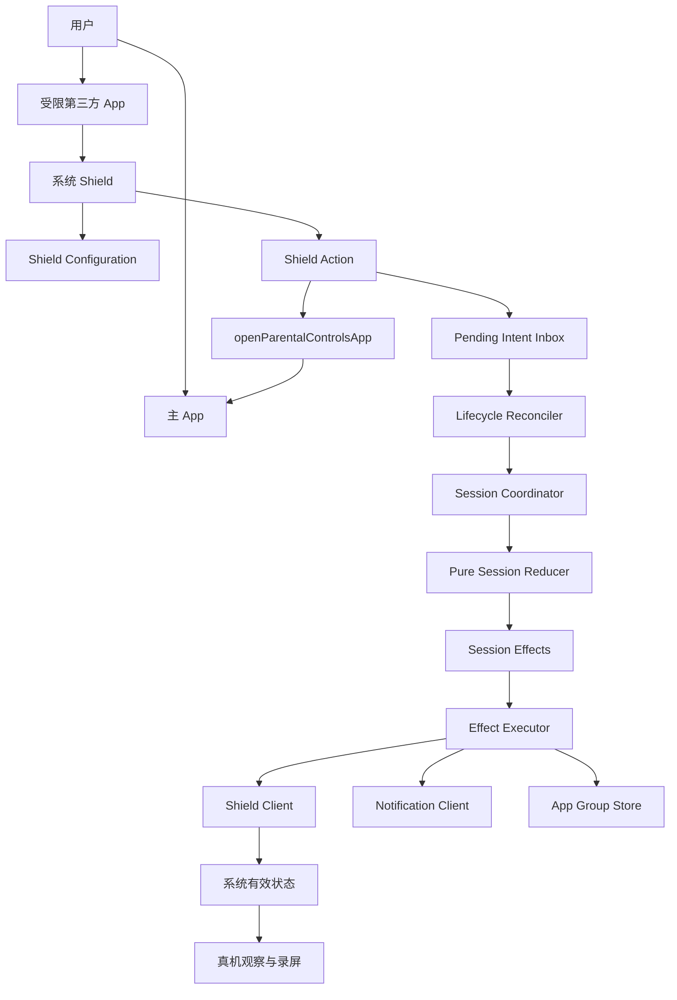

# 自律宠物 iOS 工程架构 v1.1

> 文档状态：**已验收（APPROVED FOR P0 IMPLEMENTATION）；不是 P1、Apple 账户、GitHub、TestFlight 或发布授权**  
> 日期：2026-08-10  
> 当前权威产品文档：[自律宠物 PRD v0.1.5](/Users/USER/Documents/app/自律宠物_PRD_v0.1.5_2026-08-10.md)  
> 前序架构：[自律宠物 iOS 工程架构 v1.0](/Users/USER/Documents/app/自律宠物_iOS工程架构_v1.0_2026-08-10.md)  
> 审查决策：[四份审查汇总与采纳决策](/Users/USER/Documents/app/自律宠物_iOS工程架构_四份审查汇总_2026-08-10.md)  
> 适用阶段：P0-A / P0-B / P0-C 技术门禁  
> 性质：工程架构规格；**不是创建工程、编码、Apple 账户操作、GitHub 上传或发布授权**  
> 计划项目路径：`/Users/USER/Documents/app/自律宠物-iOS`（当前尚未创建）

---

## 1. 一屏架构结论

v1.1 保留 v1.0 的主体：

- 原生 SwiftUI；
- Apple `FamilyControls`、`ManagedSettings`、`ManagedSettingsUI`、`DeviceActivity` 和 `UserNotifications`；
- 四个产品 Target + 一个本地单元测试 Target；
- 主 App 协调、纯 Reducer 决策、Apple Client 执行副作用；
- App Group 单写入者、版本化信封和幂等消费；
- 命令层、本地状态层、真机观察层严格分离；
- P0 无第三方运行时依赖、无账号、无服务器、无正式宠物资产。

v1.1 新增或收紧：

1. P0-A / P0-B / P0-C 连续止损门禁；
2. `openParentalControlsApp` 与 App Group 可见性最早验证；
3. 强制终止、冷启动、撤权、时间异常和传播延迟恢复；
4. 申请取消、多次独立通行窗口和通知 generation；
5. `ProductError`、命令回执和用户可见状态映射；
6. 撤权后结束旧会话、重新授权后从新会话开始；
7. 正向、委婉、鼓励式界面与内部工程状态分离；
8. Git、证据、测试和 P0 PASS/FAIL 口径收口。

本架构只证明“如何验证能否实现”，不证明 Apple 闭环已经可行，也不证明宠物具有行为增量。

---

## 2. 第一性原理、前提与失败方式

### 2.1 根目标

P0 只回答：

> 在 Apple 公开 API 范围内，是否能在真实 iPhone 17 / iOS 27.0 上可靠完成“Shield → 主 App 申请 → 解除完整选择集合 → 10/30/60 提醒 → 返回后重锁”，并在系统终止、撤权、延迟和重复事件下保持诚实状态。

### 2.2 必要条件

1. Family Controls 授权、选择与 entitlement 可合法工作；
2. Shield 能保护用户本次选择的完整集合；
3. Shield Action 能通过官方 `openParentalControlsApp` 打开本产品；
4. Extension 写入的 intent 能被主 App 热启动和冷启动可靠读取；
5. 主 App 能清除、重新施加本产品的完整 Shield 集合；
6. 通行 deadline 能跨后台、终止和重启恢复；
7. 返回、取消、主动结束、超时、撤权均为幂等状态迁移；
8. 通知只是提醒，不是时间或系统状态权威；
9. UI 不把“调用已执行”写成“系统已生效”；
10. 未完成和故障仍保持正向、诚实、可重新开始的体验。

### 2.3 对抗式攻击

| 攻击或误用 | 假通过方式 | 阻断证据 |
|---|---|---|
| 连点 Shield 按钮 | 重复 intent 被当成多次申请 | intentID + generation + TTL + 幂等消费 + 真机快速连点 |
| Extension 写后立刻退出 | 主 App 读到旧 UserDefaults | P0-A 可见延迟、丢失、重复、冷启动专项 |
| App 在通行中被杀 | 内存计时丢失 | 持久化 deadline + 冷启动 reconciliation |
| 用户回拨系统时间 | 伪造未超时或完成 | wall-clock/uptime 对照 + anomaly 分支 + 真机测试 |
| 撤权再授权 | 旧窗口被无限续杯 | 撤权结束旧会话；重新授权回 `IDLE` |
| 通知重复点击 | 重复重锁或重复结算 | notification generation 校验 + Reducer 幂等 |
| 另一个 Screen Time App 并存 | 本 App 自称保护成功 | 只管理本 Store；无法协调即恢复/FAIL，不声称检测对方 |
| Shield 传播延迟 | 命令回执冒充真实结果 | 三层证据 + 双向传播延迟录屏 |
| 用户未完成 | 负向文案制造弃用 | 内部 outcome 与正向 UserFacingState 分离 |

---

## 3. 官方能力与复用决策

### 3.1 Apple 官方事实

- Apple 将 [`ShieldActionResponse.openParentalControlsApp`](https://developer.apple.com/documentation/managedsettings/shieldactionresponse/openparentalcontrolsapp) 定义为打开负责当前 Shield 的家长控制 App，iOS 26.5+ 可用；它是 P0-A 首选且唯一预置的 Shield→App 路径。
- Apple 对 [`ManagedSettingsStore`](https://developer.apple.com/documentation/managedsettings/managedsettingsstore) 明确说明：设置为 `nil` 会删除本 App 的配置，但系统不保证该配置最终支配设备行为；因此属性赋值不是系统生效证明。
- [`AuthorizationCenter`](https://developer.apple.com/documentation/familycontrols/authorizationcenter) 的授权状态可能因 Settings 等外部事件变化，应观察并在每次关键协调时复核。

### 3.2 开源与包生态核验（2026-08-10）

| 候选 | 许可/维护代理 | 取舍 |
|---|---|---|
| [normalengineering/normal](https://github.com/normalengineering/normal) | MIT；2026-07 有提交；4 个开放 issue | **借鉴**协议边界、Sendable DTO、可替换 Shield Store 和测试思路；不引入依赖、不复制产品逻辑 |
| [awaseem/foqos](https://github.com/awaseem/foqos) | MIT；2026-08 活跃；12 个开放 issue | **借鉴**Extension 短生命周期、持久化 grant/monitor 分工；其直接软解锁流程不符合本产品原因页，不依赖/Fork |
| [kboy-silvergym/screen_time_api_ios](https://github.com/kboy-silvergym/screen_time_api_ios) | BSD-3-Clause；最后代码提交 2023-10；Flutter 插件 | 技术栈和维护节奏不匹配，不采用 |
| [YazanHalawa/Explore-iOS-15-Screentime-API](https://github.com/YazanHalawa/Explore-iOS-15-Screentime-API) | 无明确许可；2021 年示例 | 仅作历史参考，不复制、不依赖 |
| [Leo890728/Learnity](https://github.com/Leo890728/Learnity) | 无明确许可；小型项目 | 无许可且证据不足，不复制、不依赖 |

结论：核心闭环采用 Apple 原生 API 自研；P0 不增加第三方运行时或供应链风险。MIT 项目只作为架构模式参考，任何未来代码复用必须单独做许可、版本和差异审查。

---

## 4. 技术基线

| 项目 | P0 决策 |
|---|---|
| UI | SwiftUI |
| 语言/工具链 | Swift 6.3 / Xcode 26.6 当前基线 |
| 并发 | Swift 6 Strict Concurrency |
| App UI 隔离 | Default Actor Isolation = MainActor |
| 状态观察 | Observation / `@Observable` |
| 导航 | 单一 `NavigationStack` + 类型化 `AppRoute` |
| 系统限制 | FamilyControls + ManagedSettings + ManagedSettingsUI |
| 系统计划 | DeviceActivity |
| 通知 | UserNotifications 本地通知 |
| 跨进程运输 | App Group UserDefaults，独立 Key + Codable Data |
| 单元测试 | Swift Testing |
| 真机 UI/系统验证 | 人工步骤 + 录屏；不由单元测试替代 |
| 第三方运行时依赖 | 无 |
| 服务端/账号/分析 SDK | 无 |

P0 不使用 Swift 6.4/Xcode 27 beta 专属能力。最低 iOS 版本仍在 P0 后根据目标用户设备决定；当前真机范围只验 iOS 27.0。

---

## 5. Target 拓扑与冻结标识

| Target | 类型 | Bundle ID | 唯一责任 |
|---|---|---|---|
| `DisciplinedPet` | iOS App | `com.cczij.disciplinedpet` | 授权、选择、状态机、申请、通知、协调、诊断 |
| `DisciplinedPetMonitor` | Device Activity Monitor Extension | `com.cczij.disciplinedpet.monitor` | 生命周期回调转为版本化 monitor event |
| `DisciplinedPetShieldConfiguration` | Shield Configuration Extension | `com.cczij.disciplinedpet.shieldconfiguration` | 最小、正向、可理解的 Shield 外观与按钮 |
| `DisciplinedPetShieldAction` | Shield Action Extension | `com.cczij.disciplinedpet.shieldaction` | 记录按钮 intent 并返回官方系统响应 |
| `DisciplinedPetCoreTests` | Unit Test Bundle | 不适用 | Reducer、deadline、信封、幂等与恢复 |

共同 App Group：

```text
group.com.cczij.disciplinedpet
```

P0 不创建 Report Extension、Widget、Live Activity、Watch App、Share Extension、UI Test Target、数据库 Target 或网络模块。

---

## 6. P0 连续门禁

### 6.1 P0-A：Apple Capability Spike

按以下顺序验证；任一核心项 FAIL，停止 P0-B：

1. 经单独授权后的签名、App Group 和 Family Controls entitlement；
2. 授权/拒绝/重新授权与 App 选择；
3. Shield 实际出现；
4. Shield Action 返回 `openParentalControlsApp` 并打开本产品；
5. Extension intent → App Group → 主 App 热/冷启动可见性；先用独立试测批次记录分布并冻结最大等待上限，再用独立验收批次验证。在冻结上限内不得出现丢失、错误导航或旧 intent 被当作新请求；不满足则先评估 App Group 文件容器传输，不进入 P0-B；
6. 清除本次完整选择集合；
7. 重新施加完整集合；
8. 记录清除和重锁的真实传播延迟；
9. 主 App 已在后台的热启动路径通过 scene 激活 reconciliation 正确打开申请上下文；
10. Shield 点击“返回专注”关闭后，再次打开同一受限 App 仍然出现 Shield。

### 6.2 P0-B：闭环集成

P0-A 全部必要项通过后才做：

- 原目标、解除范围、预设/自定义原因；
- 申请取消；
- 每次申请独立 60 分钟窗口；
- 每个窗口内部统一的 10/30/60；
- 同一专注跨窗口累计通行时长；
- 主 App/通知返回；
- 主动结束、超时和最小诊断页。

### 6.3 P0-C：恢复与红队

- 通行中强制终止与冷启动；
- 设备重启；
- 专注/通行中撤权；
- 快速连点、重复和过期 intent；
- 通知关闭、延迟、重复响应；
- 通知权限关闭 + 通行中 App 被终止 + 期限到达后的真实召回边界；
- 系统时间前拨/回拨和时区变化；
- token 失效、共享数据损坏；
- 其他 Screen Time App 并存；
- 双向传播延迟阈值冻结与最终 PASS/FAIL。

### 6.4 P0.5 Behavior Gate

这是 P0 与 P1 之间的非开发门禁，不是代码模块或新 Target。使用故事板、静态角色方向或可说明演示验证宠物是否促进开始、坚持或返回。未经新授权不使用 TestFlight、不制作完整三宠资产。P0 技术通过不会自动进入 P1。

---

## 7. 总体运行与依赖方向



依赖只允许：Presentation → Application → Domain/Ports；Infrastructure 实现 Ports；Extensions 只依赖 Shared DTO 和 Apple Framework。Domain 禁止 import SwiftUI、FamilyControls、ManagedSettings、UserNotifications 或文件系统。

---

## 8. 主 App 分层

### 8.1 Presentation

- `AuthorizationView`
- `AppSelectionView`
- `FocusSetupView`
- `FocusSessionView`
- `AccessRequestView`
- `AccessWindowView`
- `RecoveryView`
- `P0DiagnosticsView`

规则：

- 单根 `NavigationStack`；
- 页面只接收实际渲染的窄字段；
- view-local 状态使用 `private @State`；
- App 级模型用 `@MainActor @Observable`；
- 系统同步和恢复副作用不散落在多个 View 的 `.onAppear`；
- P0 不引入 `TabView`、信息流或正式宠物页面。

### 8.2 Application

- `SessionCoordinator`：唯一业务协调入口；
- `EffectExecutor`：按顺序执行 Reducer 产生的 Effect；
- `AppLifecycleReconciler`：active/launch/notification/intent 前先对账；
- `AuthorizationCoordinator`：观察并复核授权；
- `IntentInboxReader`：读取、重试、校验和消费 intent；
- `NotificationResponseBridge`：把通知动作转成事件；
- `P0DiagnosticsModel`：只读聚合三层证据。

P0 先保留一个 `SessionCoordinator`；只有实现中职责实质膨胀时才进一步拆分，不预先堆叠抽象。

### 8.3 Domain

- `FocusSession`
- `FocusSessionState`
- `SessionOutcome`
- `AccessWindow`
- `AccessReason`
- `SessionEvent`
- `SessionEffect`
- `SessionReducer`
- `DeadlinePolicy`
- `GrowthSettlementPolicy`
- `ProductError`

优先采用不可变 `struct/enum`，符合 `Codable + Equatable + Sendable`。Reducer 不读取当前时间；时间作为事件上下文注入。

### 8.4 Infrastructure

- `FamilyControlsAuthorizationClient`
- `ActivitySelectionStore`
- `ShieldProtectionClient`
- `DeviceActivityClient`
- `LocalNotificationClient`
- `AppGroupStore`
- `ProductEventStore`
- `SystemTimeSource`

全部通过协议注入；测试使用隔离内存实现，不 subclass 具体 Client。

---

## 9. 状态机与正向状态映射

### 9.1 产品状态

```text
IDLE
  → CONFIGURING
  → FOCUSING
      → SHIELD_PRESENTED
          → FOCUSING                 # 直接返回
          → REQUESTING_USE
              → FOCUSING             # 取消申请
              → ACCESS_WINDOW_ACTIVE
                  → FOCUSING_INTERRUPTED
                  → ACCESS_TIMED_OUT
      → COMPLETED
      → ABANDONED
      → RECOVERY_REQUIRED
```

`ABANDONED`、`ACCESS_TIMED_OUT`、`RECOVERY_REQUIRED` 是内部工程名，不进入用户界面和本地化文案。

### 9.2 瞬时 Effect 状态

```text
APPLYING_SHIELD
CLEARING_SHIELD
REAPPLYING_SHIELD
PERSISTING
RECONCILING
```

瞬时状态只防重复副作用，不代表系统结果。

### 9.3 状态映射

| 内部结果 | 成长结算 | 系统动作 | 用户可见表达 |
|---|---|---|---|
| 完成且未正式申请 | 基础成长 + 无申请加分 | 解除本轮 Shield | 温暖庆祝 |
| 完成且曾申请 | 基础成长 | 解除本轮 Shield | 温暖庆祝，不显示“少了奖励” |
| 取消申请 | 不改变资格 | Shield 保持 | 返回目标继续 |
| 通行中返回 | 延后到最终完成 | 发出重锁命令 | “已请求恢复保护，我们继续” |
| 60 分钟到期 | 不触发完成成长 | 保持解除、取消提醒 | “这次先到这里，目标仍在” |
| 主动结束 | 不触发完成成长 | 解除、取消提醒 | “你已经迈出一步，下次继续” |
| 撤权 | 不触发完成成长 | 停止承诺保护、结束旧会话 | “保护暂时不可用，重新开启后再一起开始” |
| 系统状态不确定 | 暂不结算 | 进入恢复 | 诚实说明恢复路径，不使用惩罚色 |

既有好感度、共同回忆和历史在所有未完成/故障状态下永不减少。

### 9.4 Reducer 输入输出

Reducer 输入：当前 session、明确事件、`TimeObservation`、已知本地命令回执。输出：新 session、零或多个 Effect。

关键事件包括：

```text
startRequested
shieldActionReceived
accessRequestCancelled
accessRequestSubmitted
returnRequested
accessDeadlineReached
sessionCompletionRequested
sessionEndRequested
authorizationChanged
authorizationRevoked
notificationResponseReceived
appBecameActive
sharedRecordCorrupted
commandDispatched
```

关键 Effect 包括：

```text
applyShield(selection)
clearShield(selection)
scheduleAccessNotifications(window)
cancelAccessNotifications(windowGeneration)
persistSnapshot
appendProductEvent
presentRecovery(error)
```

---

## 10. Shield 命令语义

`ManagedSettingsStore.shield` 的属性赋值没有通用 throwing 成功回调。架构不再使用含糊的“本地确认无异常”，统一使用：

> **本地调用已执行：代码完成前置校验并执行同步属性赋值；这只证明本 App 发出了配置请求，不证明系统有效状态已经变化。**

`ShieldCommandReceipt` 只允许记录：

```text
commandID
sessionID
generation
kind = apply | clear | reapply
requestedAt
localDispatch = invoked | preconditionRejected
preconditionError?
```

禁止出现 `shieldSucceeded = true`、`systemProtected = true` 等字段。即使回读本 Store 的配置，也只能证明本 App 配置值，不证明最终设备行为。

UI 在调用后使用“正在同步保护设置…”或“已请求恢复保护”等诚实表达；不得用固定等待动画假装知道真实完成时间。P0 根据实测延迟决定过渡提示持续时间和可用性文案。

---

## 11. 跨进程 App Group 协议

### 11.1 物理边界

主 App、Shield Action Extension 和 Device Activity Monitor 是不同进程。Actor、锁和串行队列只保护单进程内存，不能替代跨进程协议。

### 11.2 单写入者

| 记录 | 唯一写入者 | 读取者 |
|---|---|---|
| `sessionSnapshot` | 主 App | 主 App、Extensions |
| `pendingShieldIntent` | Shield Action Extension | 主 App |
| `monitorEventQueue` | Monitor Extension | 主 App |
| `productEventHistory` | 主 App | 主 App |

主 App 不删除 Extension 的源记录，只在自己的 snapshot 写入 `lastConsumedIntentID` 和 `lastConsumedMonitorSequence`。

### 11.3 版本化信封

```text
schemaVersion
recordID / sequence
sessionID
generation
createdAt
expiresAt?
payload
```

未知 schema、解码失败、session/generation 不匹配或 TTL 过期均拒绝执行副作用，进入脱敏诊断或恢复。

### 11.4 P0 存储

使用：

```text
UserDefaults(suiteName: "group.com.cczij.disciplinedpet")
```

每类记录独立 Key、编码为 `Data`。不同 Key 无事务保证，因此所有恢复依赖信封、幂等和 reconciliation，不依赖“同时写成功”。

P0-A 必须先实测 Extension→App 可见性。只有证据表明 UserDefaults 不满足时，才评估 App Group 文件容器；不预建 SQLite、SwiftData、WAL 或 FileCoordinator。

---

## 12. Pending Intent 协议

### 12.1 Shield 按钮映射候选

P0-A 先验证以下最符合产品目标的映射：

| Shield 动作 | 用户标签 | Extension 行为 | 系统响应 |
|---|---|---|---|
| primary | 返回专注 | 不创建正式申请；如系统回调可可靠识别，仅记录脱敏补充事件 | `.close` |
| secondary | 申请使用 | 写入 pending intent | `.openParentalControlsApp` |

直接返回是否可可靠记录仍由真机决定；即使可记录，也不作为奖励或核心闭环的前置条件。若系统布局、可访问性或按钮语义与预期不同，只能在 Apple 公开能力内调整，并写入 P0 证据。

### 12.2 Extension 写入

Shield Action 只做：

1. 读取只读 session snapshot；
2. 校验 session/generation；
3. 对同一未过期请求去重；
4. 写入新的 `PendingShieldIntent`；
5. 返回 `.openParentalControlsApp`；
6. 立即结束，不等待主 App 回写。

P0 不使用 URL Scheme 或 Universal Link fallback。

### 12.3 主 App 读取

App 在冷启动、`scenePhase == .active`、`UIApplication.didBecomeActiveNotification` 和官方打开路径进入时执行 reconciliation 并读取 inbox；不得依赖 `onOpenURL`。若首次读不到新 intent，可执行**有界、可取消、可注入 Clock 的短重读**。P0-A 先用独立试测批次记录热启动、冷启动、快速连点的可见延迟并冻结最大等待上限，再用独立验收批次验证；批次数量、上限和设备条件在测试方案中预先登记，不得看完最终结果后倒推阈值。冻结上限内出现 intent 丢失、错误导航或旧请求误消费时，先评估 App Group 文件容器传输，不进入 P0-B。测试不得使用真实 sleep。

### 12.4 消费与取消

- 合法 intent 仅消费一次；
- 原因页取消也写入 `lastConsumedIntentID`；
- 取消不清 Shield、不调度通知、不改变无申请加分资格；
- 已消费、旧 generation、过期或损坏 intent 不得再次导航；
- 多个快速动作只需形成一个可理解的申请入口，不要求保存每次连点。

---

## 13. 通行窗口与时间模型

### 13.1 多窗口规则

- 每次正式申请创建独立 `AccessWindowID` 和 `windowGeneration`；
- 第一个清 Shield 调用的执行时刻是该窗口逻辑起点；
- 10/30/60 均从该窗口起点派生；
- 返回并重锁后再次申请创建新窗口，不重用旧 deadline；
- 同一专注累计 `totalAccessWindowDuration`；
- 不记录各 App 实际前台时长。

### 13.2 持久化时间

跨进程和重启权威必须使用绝对 `Date`：

```text
startedAt
deadline
wallClockAtWrite
systemUptimeAtWrite
```

时区变化不会改变绝对 `Date`，只影响显示。单次进程存活期间可用 uptime/连续时钟与 wall clock 对照检测明显跳变；设备重启导致 uptime 回退时标记 reboot reconciliation。不能仅依赖单调时钟，因为它无法独立跨设备重启恢复 wall deadline。

### 13.3 Reconciliation

以下入口先对账再响应用户：

- App 启动或进入 active；
- 消费 Shield intent；
- 收到通知动作；
- 用户返回、完成或主动结束；
- Monitor event 到达；
- 授权状态变化。

若 `now >= deadline`：进入 `ACCESS_TIMED_OUT`，取消剩余通知，不重锁。首次把当前窗口协调到该状态时，按 `timeoutClearGeneration`（或等价命令 generation）对完整限制集合发出一次幂等清 Shield 调用；当前 generation 已有 `ShieldCommandReceipt` 时不重复，回执缺失或损坏时允许安全重发。只记录“本地调用已执行”，不宣称系统已解除。

若时钟明显回拨、snapshot 与 uptime 不可协调：不进行奖励结算，进入恢复路径并记录 `clockAnomaly`。具体容忍区间在 P0-C 根据系统事实冻结。

---

## 14. 通知架构

通知 ID：

```text
access.<sessionID>.<sessionGeneration>.<windowGeneration>.<10|30|60>
```

规则：

1. 三个通知从同一窗口起点预调度；
2. 返回、主动结束、撤权或取消当前窗口时取消该 generation 尚未触发的通知；
3. 处理通知动作前校验 session、session generation、window generation 和当前状态；
4. 主 App 与通知同时触发返回时，Reducer 只产生一次重锁 Effect；
5. 通知权限关闭仍允许专注和申请；UI 明确提醒不可用；
6. 通知关闭不进入 `RECOVERY_REQUIRED`；
7. 通知不包含自定义原因、App 名称或敏感目标；
8. 通知投递、Badge 或点击都不是 deadline/Shield 真值；
9. 不把 Badge 当作通知关闭后的可靠 fallback；
10. 取消待发通知只是尽力操作；即使取消调用后通知已经进入系统投递队列，通知响应处理端仍须以 session/window generation 校验作为最终防线，过期响应静默丢弃；
11. 通知权限关闭且 App 被终止时，不承诺静默唤醒、后台回调或角标召回；下次可执行时按持久化 deadline 对账，并把无法主动召回如实记录为产品限制。

---

## 15. 授权与撤权恢复

### 15.1 观察点

- 订阅/读取 `AuthorizationCenter.authorizationStatus`；
- App launch/active；
- 开始专注前；
- 清 Shield/重锁前；
- notification response 与 intent consumption 前。

### 15.2 撤权确定规则

一旦在可执行时刻确认授权不再 approved：

1. 取消当前会话所有待发通知；
2. 将 outcome 记为内部 `endedByAuthorizationChange`；
3. 不触发完成成长结算；既有成长和历史完全保留；
4. 不继续承诺 Shield、clear 或 reapply 已生效；
5. 持久化会话终止与脱敏错误；
6. UI 显示正向恢复文案并提供重新授权、返回首页、删除数据；
7. 重新授权成功后回 `IDLE`，不自动恢复旧会话或旧通行窗口。

这条规则同时阻断“撤权→重授权→旧窗口续杯”和虚假保护状态。

---

## 16. ProductError 分类

| 类别 | 例子 | 自动重试 | 会话处理 | 用户表达 |
|---|---|---|---|---|
| `transient` | 暂时读取不到新 intent | 有界重试 | 保持当前安全状态 | “正在同步，请稍等” |
| `authorizationRequired` | 授权拒绝/撤销 | 否 | 结束旧会话 | 正向授权恢复入口 |
| `entitlementUnavailable` | 能力未配置/不可用 | 否 | P0 BLOCKED/FAIL 评审 | 不显示保护已开启 |
| `systemLimitation` | 公开 API 无法完成目标 | 否 | P0 FAIL 评审 | 诚实说明暂不可用 |
| `storageCorrupted` | snapshot/intent 解码失败 | 否 | 拒绝副作用、恢复或结束 | 保留重新开始入口 |
| `invariantViolation` | 不可能的状态迁移 | 否 | 停止副作用 | 温和恢复，不暴露内部术语 |
| `unknown` | 未分类系统问题 | 最多一次且需幂等 | 保守恢复 | 不伪装成功 |

日志只记录分类、代码、session 短 ID 和时间，不记录 token、原因正文、账号或 secret。

---

## 17. Device Activity 与其他 Screen Time App

Monitor Extension 只把 interval 生命周期转为有 sequence 的只读辅助事件；不直接宣布完成、不作为唯一计时器、不处理成长结算。

本产品只操作自己命名的 `ManagedSettingsStore` 配置，不清除其他 App 的配置，也不假设能够检测其他 Screen Time App。P0-C 只记录并存时的实际行为：

- 若本 App 配置与系统观察一致，记录限制；
- 若无法协调但可恢复，进入 `RECOVERY_REQUIRED`；
- 若核心闭环在常见并存场景下不可可靠实现，进入 P0 FAIL 评审。

---

## 18. SwiftUI、导航、本地化与情绪设计

### 18.1 UI 状态所有权

- App 根部用 `private @State` 持有 `@MainActor @Observable SessionCoordinator`；
- View 只接收实际读取的字段或小型 presentation model；
- Domain 值保持 `Equatable`，避免相同赋值造成无意义刷新；
- 系统生命周期副作用集中在 Reconciler，不由多个页面竞争执行；
- Route 使用稳定 `Hashable` ID，不保存原始 token。

### 18.2 导航

```text
authorization
appSelection
focusSetup
focusSession(sessionID)
accessRequest(intentID)
accessWindow(sessionID, windowID)
recovery(errorCategory)
diagnostics
```

Shield→App 只依赖官方响应与 inbox 恢复；页面路由不是状态权威。

### 18.3 本地化

- 主 App 与各 Extension 都必须有可用 String Catalog；
- 非 View 层携带用户文案时使用 `LocalizedStringResource`，不提前解析成普通 `String`；
- Extension 文案从自己的 bundle 解析；
- 禁止字符串拼接构造句子；变量使用插值并添加翻译注释；
- 使用 leading/trailing、Dynamic Type 和可扩展布局；
- 中英文核心概念表在视觉/本地化阶段冻结。

### 18.4 正向陪伴映射

- 内部 `FAIL/ABANDONED/TIMED_OUT/ERROR` 永不直接显示；
- 非完成/恢复界面不使用惩罚性红色、叉号、剧烈抖动或宠物悲伤；
- 使用温暖中性色、柔和琥珀色或安静蓝色；
- 完成状态才使用温暖庆祝和成功触觉；
- 正向表达不能掩盖权限丢失或 Shield 未证实。

---

## 19. Swift 并发边界

- 主 App UI、Router、Coordinator、EffectExecutor：`@MainActor`；
- Domain Reducer 和 DTO：不可变、`Sendable`、无 actor 依赖；
- Shared 文件显式声明隔离，避免不同 Target 的默认隔离产生语义漂移；
- Extension 回调内只执行同步短操作，不创建长期无结构任务；
- Apple Screen Time 框架优先封装在 `@MainActor` Client 或显式隔离边界内。只有 Xcode 26.6 出现具体且可复现的 SDK `Sendable` 标注诊断时，才允许对精确框架使用 `@preconcurrency import`；必须记录诊断、影响范围和未来删除条件，禁止预先或全局压制并发检查；
- 不使用 `Task.detached`、`nonisolated(unsafe)` 或无证明的 `@unchecked Sendable`；
- Actor 不充当跨进程锁；
- Actor 内不加手动锁，也不在锁内 `await`；
- 每个异步流程在 suspension 后重新核对 generation，避免 actor reentrancy 使用旧状态；
- 可取消的 intent 重读/恢复任务在页面或 scene 失效时取消。

P0 没有重型计算，不需要为了“后台性能”提前引入 `@concurrent`。

---

## 20. 本地数据、隐私与诊断

### 20.1 P0 共享状态

- schema、sessionID、generation；
- session/product state；
- opaque selection 编码；
- 当前 AccessWindow、deadline、累计通行时长；
- last consumed intent/monitor sequence；
- notification generation；
- command receipts；
- authorization observation；
- ProductError 分类。

### 20.2 不记录

- 原始 token 的日志/显示；
- 各 App 精确前台时长；
- 完整设备 App 清单；
- 云分析、广告 ID、账号；
- 自定义原因进入 Extension 或通知；
- 以本地布尔值生成“系统已保护”结论。

### 20.3 三层诊断

1. **命令层：** 哪个 API/配置请求何时执行；
2. **本地状态层：** snapshot、intent、monitor、notification；
3. **系统观察层：** 测试人员实际看到 Shield 的时间与录屏。

诊断页只显示脱敏 ID、数量、时间、状态类别和错误分类。第三层只能由真机证据人员注记，不由 App 自动升级。P0Diagnostics 只服务 PASS/BLOCKED/FAIL 取证，不制作图表、趋势分析、后台系统或正式视觉。

### 20.4 本地事件与候选口径映射

第一版只记录本产品明确发生的事件，不上传：

| 候选口径 | 本地事件/字段 | 边界 |
|---|---|---|
| 正式申请次数 | `accessRequestSubmitted` | 不代表实际打开或使用了某 App |
| 申请后返回率 | `accessWindowReturned / accessWindowOpened` | 只表示用户触发返回流程 |
| 单会话累计通行占比 | `totalAccessWindowDuration / plannedFocusDuration` | 代理信号，不判断动机 |
| 主动结束率 | `sessionEndedByUser / sessionStarted` | UI 不展示负向标签 |
| 60 分钟到期率 | `accessWindowTimedOut / accessWindowOpened` | 通知关闭子集单独分层 |
| Day 7 主动复用 | 新会话 `launchSource == direct` 与本地日期 | 属于 P0.5/P1 行为验证，不是 P0 技术 PASS |

事件 schema 在 P0 期间冻结；公式必须版本化。Shield 展示、直接返回、各 App 前台时长和用户真实学习结果不由这些字段推断。

---

## 21. 测试架构

### 21.1 Swift Testing 单元测试

测试纯行为，不测试 Apple 框架内部实现。每个测试独立创建 fixture；不依赖顺序、不共享可变全局、不用 `Task.sleep`。

必须覆盖：

1. 状态机合法/非法迁移；
2. 取消申请不产生清 Shield、通知或资格变化；
3. 每次申请建立独立窗口和 generation；
4. 10/30/60 从当前窗口同一起点派生；
5. 跨窗口累计通行时长；
6. 59:59 返回与 60:00 到期边界；
7. 通知 generation 过期/重复响应被拒绝；
   - 包含“取消请求已发出但通知动作仍到达”的竞态，generation 校验必须静默拒绝旧响应；
8. 返回只产生一次重锁 Effect 并取消剩余通知；
9. 主动结束和超时不触发完成成长结算；
10. 撤权结束旧会话、重新授权不恢复旧窗口；
11. 强制终止后 snapshot 恢复；
12. wall clock/uptime 异常分支；
13. 旧 intent、重复 intent、未知 schema 和损坏数据；
14. ProductError 到恢复策略与正向 UserFacingState 的映射；
15. 自定义原因和 token 不进入诊断输出。

使用参数化 `@Test` 覆盖状态/时间组合；需要后续断言的值用 `#require`；异步回调用 `confirmation`；Clock 通过协议或泛型注入。Swift Testing 默认并行，App Group 文件级集成测试若确实共享资源才使用隔离临时 suite 或 `.serialized`，不得用序列化表达工作流顺序。

### 21.2 Simulator

可验证页面导航、正向状态映射、Reducer、App Group 编解码、通知请求 smoke、Dynamic Type/深色模式和基础可访问性。不能证明 entitlement、Shield、官方打开路径、真实清除或重锁。

### 21.3 真机专项补充

- 主 App 已在后台时，从 Shield 触发官方打开路径，验证 scene 激活 reconciliation、inbox 读取和申请页上下文；
- Shield 点击“返回专注”并 `.close` 后，立即再次打开同一受限 App，确认 Shield 仍持续生效；
- App Group 可见性先用独立试测批次冻结等待上限，再用独立验收批次检验零丢失、零错误导航；
- 通知权限关闭、通行中 App 被终止、期限到达后，记录系统真实召回能力；下次可执行时必须按 deadline 正确协调；
- Device Activity Monitor Target 在 P0-A 创建并完成签名/共享配置骨架，Monitor 事件的正式接入与恢复验证放在 P0-C，避免扩大 P0-A 调试面。

### 21.3 真机

PRD §8.5 的最新证据矩阵是最低矩阵。新增要求：

- P0-A 先完成官方打开与 App Group 可见性；
- 通行中上滑终止后冷启动恢复；
- 撤权后旧会话不自动恢复；
- 清除/重锁分别在 0s/30s/1m/5m 观察；
- 初始传播数据产生后冻结可接受阈值，再作 P0-C 最终判定；
- 加速模式证据不能计入核心 PASS；
- 至少一次完整真实 10/30/60 流程。

---

## 22. P0 证据与判定

每项记录：测试编号、日期、设备、iOS、Xcode、build、权限、前置状态、步骤、命令时间、首次观察时间、实际结果、PASS/FAIL、录屏文件名和限制。

P0 结论：

- `PASS`：全部必要条件与冻结阈值通过；
- `BLOCKED`：entitlement、账号、设备等外部条件未满足；
- `FAIL`：公开能力或可靠性不满足 PRD；
- 不使用容易掩盖门禁的总括 `CONDITIONAL PASS`。允许降级必须逐项标记，并确认不破坏 PRD 核心后才能算该项 PASS。

加速测试只用于 Reducer、UI 和快速集成。最终证据必须包含真实时长、冷启动和真机 Shield 观察。

---

## 23. Build、Git 与外部授权

### 23.1 构建设置

- Swift Language Mode：Swift 6；
- Strict Concurrency：Complete；
- 主 App Default Actor Isolation：MainActor；
- Extensions/Shared：显式隔离；
- Debug 可含脱敏诊断与加速配置；Release 不包含加速入口；
- Deployment Target 在 P0 后冻结；
- xcconfig 不保存 secret、Team 凭据或 provisioning 内容。

### 23.2 Git

开工授权后在 `/Users/USER/Documents/app/自律宠物-iOS` 内建立独立仓库，不把父目录作为仓库。`.gitignore` 至少排除：

```text
DerivedData/
*.xcuserstate
xcuserdata/
.DS_Store
Evidence/**/*.mov
Evidence/**/*.mp4
```

分支、初始化和 GitHub 上传仍需用户确认；不得直接 push `main`。

### 23.3 Apple 账户

创建/修改 App ID、App Group、Family Controls entitlement、provisioning、Team、TestFlight 和 App Store 都是单独外部授权。架构验收不授权任何账号动作。

---

## 24. 建议目录

```text
/Users/USER/Documents/app/自律宠物-iOS/
├── DisciplinedPet.xcodeproj
├── DisciplinedPet/
│   ├── App/
│   ├── Features/
│   │   ├── Authorization/
│   │   ├── AppSelection/
│   │   ├── Focus/
│   │   ├── AccessRequest/
│   │   ├── Recovery/
│   │   └── P0Diagnostics/
│   ├── Application/
│   │   ├── SessionCoordinator.swift
│   │   ├── EffectExecutor.swift
│   │   ├── AppLifecycleReconciler.swift
│   │   ├── IntentInboxReader.swift
│   │   └── NotificationResponseBridge.swift
│   ├── Domain/
│   └── Infrastructure/
├── Shared/
│   ├── SharedEnvelope.swift
│   ├── SharedSessionSnapshot.swift
│   ├── PendingShieldIntent.swift
│   ├── MonitorEvent.swift
│   ├── AppGroupKeys.swift
│   └── AppGroupStore.swift
├── DisciplinedPetMonitor/
├── DisciplinedPetShieldConfiguration/
├── DisciplinedPetShieldAction/
├── DisciplinedPetCoreTests/
│   ├── Reducer/
│   ├── Time/
│   ├── Reconciliation/
│   ├── SharedState/
│   └── Privacy/
├── Config/
└── Evidence/
    └── README.md
```

`Evidence/README.md` 只定义索引与命名；大型录屏放在用户确认的外部证据目录，不纳入 Git。

---

## 25. 开发顺序与止损

获得明确工程创建和相应 Apple 账户授权后：

1. 独立仓库与工程骨架；
2. Shared 信封、Reducer 和单元测试；
3. P0-A 授权/选择/Shield；
4. 官方打开路径与 intent 可见性；
5. 清 Shield/重锁与传播延迟；
6. **P0-A 判定**；未过即停止；
7. P0-B 原因、窗口、通知、返回、主动结束、诊断；
8. **P0-B 判定**；未过即停止；
9. P0-C 冷启动、撤权、时间异常、并存与红队；
10. 冻结阈值并作最终 P0 判定；
11. 进入独立 P0.5 Behavior Gate；
12. 只有技术与行为门禁均满足且获得新授权后，才制定 P1 实施计划。

P1 未来资产管线先做一只宠物的完整垂直切片验证规格、一致性与性能，再按同规格生产另外两只；这只改变生产顺序，不改变用户已确认的三宠完整范围。

---

## 26. P0 停止条件

任一成立即不能 PASS：

- 官方 Shield→本产品路径无法形成可理解申请流程；
- App Group intent 在目标真机上无法达到可靠可恢复标准；
- 无法只管理本次完整选择集合；
- 返回后无法在冻结阈值内可靠重锁；
- 清 Shield/重锁长期与产品状态不一致且无法协调；
- 撤权、终止或时间变化导致旧窗口恢复或错误结算；
- 必须使用私有 API、URL Scheme 掩盖官方路径失败或静默降级；
- 只能在 Simulator/加速模式通过；
- entitlement 无法取得或合法交付边界不成立；
- UI 必须谎称系统成功才能维持流程。

P0 FAIL 后停止完整 App 开发和正式宠物资产，不宣布绿灯；进入短期失败评审决定停止或重新定义方向，但不在本架构写死任意 48 小时时限。

---

## 27. 仍待开工授权决定

已确认：项目路径、主 Target、三个 Extension 名称/Bundle ID、App Group、一个测试 Target、iPhone 17/iOS 27.0 真机范围、无 URL Scheme、无第三方运行时依赖。

仍需：

1. 是否授权创建本地 Xcode 工程；
2. 是否授权初始化独立 Git 仓库及分支；
3. Apple Developer Team；
4. App ID/App Group/entitlement/provisioning 的具体账号动作授权；
5. P0 证据绝对路径、命名和保留策略；
6. 是否允许在工程中创建 Debug-only 加速与诊断入口。

GitHub、TestFlight、App Store、正式美术、外联、注册和付款均不在本次授权内。

---

## 28. 架构验收口径

用户验收 v1.1 只表示认可：

1. 四产品 Target + 一测试 Target；
2. P0-A/B/C 顺序门禁；
3. Reducer/Effect/Client 分层；
4. App Group 单写入者与版本化信封；
5. 官方 `openParentalControlsApp` 且无 URL Scheme fallback；
6. 命令、本地状态、真机观察三层证据；
7. 撤权结束旧会话、重新授权从新会话开始；
8. 正向 UserFacingState 与内部工程状态分离；
9. 通知 generation、多窗口、时间异常和恢复规则；
10. P0 技术通过不自动进入 P1。

建议验收语句：

> 工程架构 v1.1 验收通过；同意四产品 Target、一测试 Target、P0-A/B/C、单写入者 App Group、纯状态机、撤权结束旧会话、正向状态映射与真机证据门禁。该验收不授权创建工程、操作 Apple 账户、GitHub 上传或发布。

---

## 29. v1.0 → v1.1 变更摘要

- 权威产品基线切换为已验收 PRD v0.1.5；
- 同步多次独立通行窗口、累计时长、取消申请和正向陪伴原则；
- 落地四份审查中用户确认的 A1–A11；
- 保持 N1–N7 拒绝、D1–D6 后置；
- 增加官方/开源复用审查并决定原生自研；
- 明确 `ManagedSettingsStore` 调用不等于系统生效；
- 增加撤权确定规则、通知 generation、时间异常和 ProductError；
- P0 结论统一为 PASS/BLOCKED/FAIL；
- 增加 P0.5 Behavior Gate 与单宠物垂直切片生产顺序；
- 最终联合审查统一 Shield 本地调用术语，明确超时清 Shield 的一次性幂等规则，并补入热启动、`.close` 持续拦截、通知取消竞态和通知关闭终止场景；
- v1.0 保留不修改；v1.1 已由用户确认，可作为 P0 实施架构基线。
